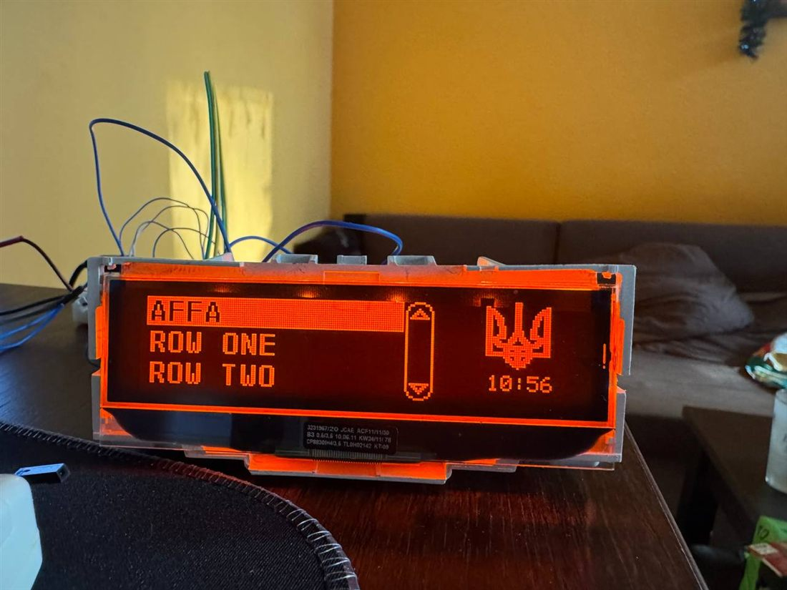

# AffaDisplay

[](https://github.com/Barbedx/AffaDisplay/actions/workflows/ci.yml)



An ESP32 driver for Renault **AFFA2 / AFFA3** OEM dash panels over CAN.
MIT · Arduino + PlatformIO · C++17 · non-blocking · no heap after `begin()`.

**[Українською](#українською)**

The library covers transport and rendering: the opening handshake, ISO-TP segmentation,
function registration, the heartbeat, key decoding and acknowledgement, and a frame builder for
each screen. It has no menus, scrolling or key gestures. Keys arrive through `onKey()`.

- Render calls never block. They return `Submitted` (a ticket and a `Result`, `[[nodiscard]]`),
  and you can make them from any task.
- Calls the panel can't do return `NotSupported`. `supports()` and `panelGeometry()` answer
  before you call.
- Long screens are copied into a library-owned pool, so your buffer is free when the call returns.
- Timeouts are retried, and renders are held while the panel is away and re-registered after a
  resync.
- 74 host tests, no hardware needed.

## Panels

| Family | Class | Sync | Data | Keys |
| --- | --- | --- | --- | --- |
| Carminat / AFFA3 | `affa::CarminatDisplay` | `0x3AF` → `0x3CF` | `0x151`, `0x1F1` | `0x1C1` → `0x5C1` |
| UpdateList / AFFA2 | `affa::UpdateListDisplay` | `0x3DF` → `0x3CF` | `0x121`, `0x1B1` | `0x0A9` → `0x4A9` |
| Instrument cluster | `affa::ClusterDisplay` | `0x3AF` → `0x3CF` | `0x121`, `0x1B1` | `0x1C1` → `0x5C1` |

| Call | Carminat | UpdateList | Cluster |
| --- | :---: | :---: | :---: |
| `setText` | 8 chars | 8 chars¹ | — |
| `setTime` | ✔ | — | — |
| `setPower` | ✔ | ✔ | ✔ |
| `showMenu` / `highlightItem` (2 × 26) | ✔ | — | — |
| `showMenuN` / `selectMenuItem` (up to 10 items, pictogram, scrollbar) | ✔ | — | — |
| `showInfoMenu` / `showInfoPopup` (3 × 8) | ✔ | — | — |
| `showPopupText` / `hidePopup` | ✔ | — | — |
| `showFullscreenText`, `showConfirmBox` / `selectBoxButton` | ✔ | — | — |
| `showNavBitmap` (48 × 48 mono) | ✔ | — | — |
| keys, acknowledged on the wire | ✔ | ✔ | — |

¹ The frame carries 12 cells; 8 is what every panel in the family is known to show.

**Status.**
- **Carminat:** everything in the table above has been seen on a real panel except the info
  popup and the confirm box. That includes an 8.3-hour soak with zero errors.
- **UpdateList:** the handshake, `setPower`, menu mode and scrolling text have been seen on a
  real panel. Setting its clock does not work. It still uses the older opening (lazy
  registration).
- **Cluster:** has never run on hardware. It comes from a single capture, and its opening
  cannot complete.
- **This tree on glass:** the link (`TwaiLink`, which is MegaOpen's TWAI link moved in)
  has been built and host-tested but has not yet driven a panel from this tree.

## Install

```ini
lib_deps =
  https://github.com/Barbedx/AffaDisplay.git#v1.1.2
build_flags =
  -std=gnu++17
  -D AFFA_PANEL_CARMINAT=1          ; at least one panel, or the build stops with #error
build_unflags = -std=gnu++11
```

Tested with PlatformIO `espressif32@6.13.0` (Arduino-ESP32 2.0.17) and `espressif32@8.0.0`
(Arduino-ESP32 3.3.12); CI builds the minimal example below on both. The examples that use
PsychicHttp (17, 18) build on 6.13.0 only.

The library is not published in the PlatformIO registry yet; install it from the Git tag.

## Minimal example

```cpp
#include <Arduino.h>
#include <AffaDisplay.h>

struct ArduinoClock final : affa::IClock {
  uint32_t millis() const override { return ::millis(); }
};

affa::TwaiLink        g_link;
ArduinoClock          g_clock;
affa::CarminatDisplay g_display(g_link, g_clock);
affa::rtos::AffaTask  g_task;

void setup() {
  Serial.begin(115200);
  g_display.onKey([](affa::Key k, affa::KeyEdge e, void*) {
    if (k == affa::Key::Pause && e == affa::KeyEdge::Click) (void)g_display.setText("PAUSED");
  }, nullptr);

  affa::TwaiConfig cfg;
  cfg.rx = GPIO_NUM_5;
  cfg.tx = GPIO_NUM_4;
  g_link.begin(cfg);
  g_display.begin();
  g_task.start(g_display);          // the library polls from its own task from now on
}

void loop() {
  // Safe from any task. The result says whether the render was queued; delivery is reported
  // later through onComplete(). See examples/03_hello.
  affa::Submitted s = g_display.setText("HELLO");
  if (s.result != affa::Result::Ok) Serial.printf("setText: %d\n", static_cast<int>(s.result));
  delay(1000);
}
```

The panel opens the conversation. Until it does, the library announces a bare `BA` every
~30 s and waits for `0x3CF: 61 11 xx`, so a silent bus is normal at first.

Using a different CAN driver? Implement `affa::ICanLink` (`trySend`, `recv`). For the link
without a panel (a sniffer), include `<AffaTwai.h>` instead; see `examples/04_sniffer`.

## Wiring

- **Transceiver:** a 3.3 V CAN transceiver between the ESP32 and the panel's CAN pair, for
  example an SN65HVD230 on a bench. For a car, use an automotive part such as the TJA1051T/3.
  Its CTX pin goes to the GPIO in `cfg.tx`, CRX to `cfg.rx`. Swapped pins give a silent bus
  and no error.
- **Bit rate:** 500 kbit/s, the `TwaiConfig` default.
- **Termination:** 120 Ω at each end of the bus. With the power off, measure between CAN-H and
  CAN-L: 60 Ω means both ends are terminated, 120 Ω means one end is missing.
- **Panel connector:** the pinout is not documented here. Take CAN-H, CAN-L, +12 V and ground
  from the panel's wiring diagram.
- **A bus with other traffic (a car):** start with `cfg.listenOnly = true`, or flash
  `examples/04_sniffer`. Listen-only never transmits or acknowledges, so it cannot disturb the
  bus. Switch to normal mode once you have seen what is on it.

## Examples

| | |
| --- | --- |
| `03_hello` | The smallest correct program. |
| `04_sniffer` | Listen-only CAN sniffer, no panel. |
| `17_mediascreen` | Web console with every render, a frame log, key capture and a self-check. Flash this first on new hardware. |
| `18_aiscreen` | Shows screens pushed by any producer (HTTP, an LLM, Home Assistant). |

## More

- [`docs/API.md`](docs/API.md): results, threading, latency, configuration.
- [`docs/WIRE.md`](docs/WIRE.md): every frame the tests assert, generated from them.
- [`docs/NOTES.md`](docs/NOTES.md): what is still unknown about the protocol.
- [`src/AffaConfig.h`](src/AffaConfig.h): every build knob.
- [`CHANGELOG.md`](CHANGELOG.md): release notes.

```
pio test -e native      # host tests
pio run                 # all example environments
```

Licence: MIT, see [`LICENSE`](LICENSE).

---

## Українською

Драйвер штатних панелей Renault **AFFA2 / AFFA3** для ESP32 через CAN.
MIT · Arduino + PlatformIO · C++17 · неблокуючий · без купи після `begin()`.

Бібліотека відповідає за транспорт і малювання: відкриття сесії, сегментацію ISO-TP, реєстрацію
функцій, серцебиття, декодування й підтвердження клавіш і збирач кадрів для кожного екрана.
Меню, прокрутки чи жестів клавіш у ній немає. Клавіші приходять через `onKey()`.

- Виклики малювання не блокують. Вони повертають `Submitted` (квиток і `Result`), і робити їх
  можна з будь-якої задачі.
- Те, чого панель не вміє, повертає `NotSupported`. `supports()` і `panelGeometry()` відповідають
  ще до виклику.
- Довгі екрани копіюються в пул бібліотеки, тож ваш буфер вільний одразу після виклику.
- Тайм-аути повторюються; поки панелі немає, рендери чекають, а після ресинку бібліотека
  реєструється знову.
- 74 тести на хості, залізо не потрібне.

Панелі, виклики, встановлення й приклад коду ті самі, що в англійській частині вище.
Встановлення: `lib_deps = https://github.com/Barbedx/AffaDisplay.git#v1.1.2` і хоча б один
`-D AFFA_PANEL_*=1`. У реєстрі PlatformIO бібліотеки ще немає. Перевірено на `espressif32@6.13.0`
і `8.0.0`.

**Підключення.** Трансивер CAN на 3,3 В (на столі SN65HVD230, в авто TJA1051T/3), 500 кбіт/с,
по 120 Ом на кожному кінці шини (без живлення між CAN-H і CAN-L має бути 60 Ом). Розпіновки
роз'єму панелі тут немає. На шину з іншим трафіком (авто) спершу підключайтеся з
`cfg.listenOnly = true` або прошийте `examples/04_sniffer`.

**Стан.**
- **Carminat:** на справжній панелі бачено все з таблиці, крім інфо-попапа й діалогу
  підтвердження, зокрема 8,3-годинний прогін без помилок.
- **UpdateList:** бачено відкриття, `setPower`, меню й біжучий текст. Годинник не ставиться.
  Відкриття досі старе.
- **Приборка:** на залізі не запускалася.
- **Це дерево на склі:** `TwaiLink` зібрано й протестовано на хості, але панель саме з
  цього дерева ще не вела.

Документи: [`docs/API.md`](docs/API.md), [`docs/WIRE.md`](docs/WIRE.md),
[`docs/NOTES.md`](docs/NOTES.md), [`CHANGELOG.md`](CHANGELOG.md). Ліцензія MIT.

---

## 🇺🇦 Ukraine

This library is developed in Ukraine. If it saved you time, consider donating to
[Come Back Alive](https://savelife.in.ua/en/) or [UNITED24](https://u24.gov.ua/).

Ця бібліотека створюється в Україні. Якщо вона зекономила вам час, задонатьте
[Повернись живим](https://savelife.in.ua/) або [UNITED24](https://u24.gov.ua/).
